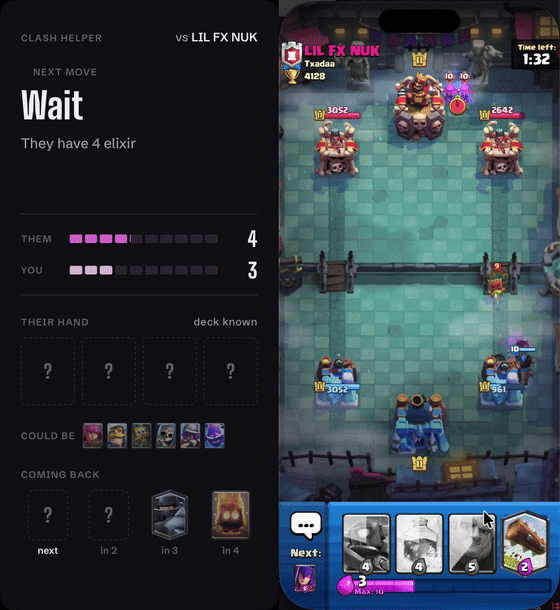

<h1 align="center">Clash Helper</h1>

<p align="center">A live coach for Clash Royale that sits beside your phone.</p>

<p align="center">
  
</p>

Clash Helper watches your match through iPhone Mirroring on a Mac. It works out which cards your opponent is holding, how much elixir they have, and tells you what to play next, where to put it, and why.

## What it shows

- **One call at a time.** `Hog Rider, right bridge: no answer in their hand`. Urgent defense calls turn red.
- **Their hand.** Clash Royale decks cycle in a fixed order, so once their cards are known the helper knows exactly which 4 they hold and which one comes next.
- **Their elixir.** Rebuilt from the match clock and every card they play.
- **A deck for you.** Picked from thousands of real battles near your trophy count, limited to decks you can build at good levels.

## Setup

Requires macOS with iPhone Mirroring and Python 3.11+.

```bash
python3 -m venv .venv
.venv/bin/pip install -e ".[dev]"
cp .env.example .env
```

1. Create a key at [developer.clashroyale.com](https://developer.clashroyale.com) with the IP `45.79.218.79`. That is the [RoyaleAPI relay](https://docs.royaleapi.com/proxy.html), so the key keeps working when your own IP changes. Put it in `.env` as `CR_API_TOKEN`.
2. Put your player tag (on your profile, without the `#`) in `.env` as `CR_PLAYER_TAG`.
3. Add a [Google AI Studio](https://aistudio.google.com/apikey) key as `GEMINI_API_KEY`. It names the opponent's cards from a short strip of frames, roughly a second after they land. Without it the helper falls back to its offline unit detector.
4. Give your terminal **Screen Recording** and **Accessibility** access in System Settings > Privacy & Security.

## Use

```bash
clash-helper                         # coach the match on your phone
clash-helper deck                    # suggest a deck from your cards
clash-helper replay match.mp4        # print the calls for a screen recording
clash-helper replay match.mp4 --panel
clash-helper record                  # save frames of a match for testing
```

Open iPhone Mirroring first. The helper snaps it to the right half of the screen and opens its panel on the left.

## How it works

1. Each frame of the iPhone Mirroring window is cropped to one fixed screen layout.
2. When a match starts, the opponent's name and clan are read off the screen and their current deck is fetched from the official API.
3. Enemy cards land with a red stopwatch and their units wear crimson level badges. Each landing is named by Gemini Flash Lite and the open [ClashRoyaleBuildABot](https://github.com/Pbatch/ClashRoyaleBuildABot) unit detector, along with the number of units and their level.
4. Because no card can repeat within 4 plays, the whole sequence of their plays is named at once, so later plays correct earlier mistakes.
5. The card cycle and elixir model update, and a small set of rules picks the call: defend, punish low elixir, attack while their answer is out of hand, avoid sitting at full elixir, or wait.

See [docs/design.md](docs/design.md) for the details.

## Limits

- Enemy spells do not show a stopwatch and are not detected yet. The cycle notices plays it missed and stops claiming a certain hand until they cycle out.
- Opponents without a clan cannot be looked up, so their deck is learned as they play it.
- On a recorded match with the opponent's deck known, 32 of 33 enemy deploys were caught and about 70% were named correctly. The unit detector predates some newer cards and evolved skins.
- 1v1 trophy matches only.

## Development

```bash
.venv/bin/pytest
python scripts/build_cards.py        # refresh card costs and art from the API
python scripts/demo.py match.mp4     # rebuild docs/demo.gif
python scripts/evaluate.py match1    # score deploy naming against hand labels in captures/
```

The unit detector weights are AGPL-3.0 and are downloaded to `~/Library/Caches/clash-helper` on first run rather than shipped here.

Clash Helper is a fan project and is not affiliated with or endorsed by Supercell.
